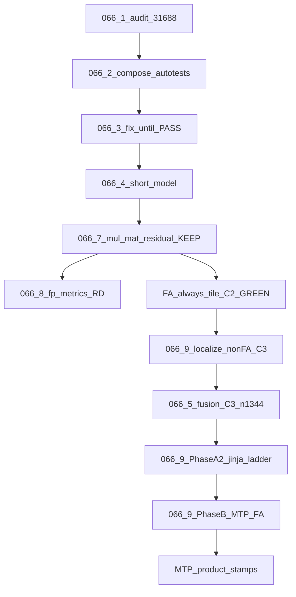

# TASK-066.0 — Overview (nomtp ubatch S8 vs S1024)

**Index:** [README-TASK066.md](README-TASK066.md)  
**Research inputs:** [`task066-hist/draft_mtp_research_task-066*.md`](task066-hist/)  
**Baseline stamp:** `logs/task066-ubatch-ladder-20261106T170944Z` (S8 vs S1024 DIFF @byte 80; `MUL_MM_MIN=8` debug)  
**Confirm stamp:** `logs/task066-ubatch-ladder-20261106T212703Z` (S8 vs S1024 DIFF @byte 182; product `MUL_MM_MIN` unset→7)  
**Post-tile ladder:** `logs/task066-ubatch-ladder-20261106T231804Z` (S1024 vs S8 DIFF @byte 329)

## Status

🟢 **066.7 KEEP** + **066.8 R&D DELIVERED** (2026-11-06).  
🟢 **FA always-tile (2026-11-07):** C2 GREEN; A0–A4 exact; C1 HELP `first_token_diff` 0→8; ladder `231804Z` DIFF@329.  
🟢 **066.9 Phase A1 DONE:** C3-n1344 + C1 GREEN via **066.5 ISWA `size_swa`**.  
🟢 **066.9 Phase A2 DONE:** last-ubatch rem cross-kernel → product `MUL_MM_MIN` default **1**; C1j + ladder `023433Z` S8≡S1024.  
🟢 **066.9 Phase B matmul KEEP:** MTP verify N=1 vs `{2,3,4}` → default **0**; `--mtp-verify`. Freeze: [TASK-066.9](TASK-066.9-fa-batch-invariance.md).  
⬜ **066.5 TODO** — ideas `size_swa` (pad128 + `n_ubatch`); prior size_base KEEP superseded; C3 + KLD vs FP16 @ 4K/16K/64K open.  
⬜ **066.10 TODO** — KV / `n_ctx` estimator under ideas formula; not closed.  
📋 **PR audit:** [TASK-066-pr-audit-registry.md](TASK-066-pr-audit-registry.md). Hist Stage 1 WAIVE ≠ Done. **MTP blocked** until explicit start (A2 DoD ✅).

## Locked decisions

1. Goal: shrink nomtp cross-ubatch drift (primary **S8 vs S1024**; also `{256,512}`).
2. Order: 066.1–066.4 done → **066.7 KEEP** → **066.8 R&D** → FA always-tile (C2) → **066.9 A1** (ISWA/C3/C1) → **066.9 A2** (jinja-ladder) → (only then) **066.9 Phase B MTP**.
3. Backend: Metal first. CUDA out of scope for this numbered track.
4. Premature WAIVE forbidden as “Done”.
5. Raising `MUL_MM_MIN` to hide mm is **not** a fix. 066.7 lowered 32→7; **A2** 7→1 (prefill rem); **B** 1→0 (MTP N=1 vs verify). `#27441` stays closed.
6. `#30100` encode N/A until encode path exists (hist recheck).
7. **Every code change ships with autotests** (hard — see below). No silent “fix then maybe test later”.
8. **Primary gate for mm work = `mul-mat-residual`**, not e2e. Ladder confirm after C3; MTP blocked until **A2**.
9. **066.9 priority:** `A1 → A2 (jinja-ladder) → B (MTP)`. C1 GREEN ≠ ladder Done. Product stays FA-on + turbo4.

## Evidence hierarchy (hard)

1. **Autotests accompany every change** — for each discrete patch/hypothesis:
   - add or extend a failing-closed corner that reproduces the bug/gap (**RED** on pre-fix HEAD);
   - implement the minimal fix;
   - same corner **GREEN**; log HELP / NO_EFFECT / REGRESS.
   - Forbidden: production/kernel edits without a new or extended autotest in the same change set; “covered by existing suite” only if that suite already fails closed on *this* gap (prove with RED before).
2. **For 066.7:** that suite is `SUITE=mul-mat-residual` (vs N=8). Do **not** run e2e ladder as the iteration gate.
3. **For long-prefill (C3):** primary gate `SUITE=ubatch-s8-s1024` C3-n1344; C2 + C3-n1280 regress locks; C1 after C3 GREEN.
4. Isolation: one lever → HELP / NO_EFFECT / REGRESS → KEEP or revert.

## Progressive DoD

1. `SUITE=mul-mat-residual` PASS. ✅ 066.7  
2. C2 FA multi-step bit-exact. ✅ always-tile  
3. Non-FA residual named (H9faOFF). ✅ 066.9 localize  
4. **C3-n1344 GREEN** (066.5 ISWA) → C1 GREEN. ✅ Phase A1  
5. **Phase A2:** jinja-ladder S8 vs S1024 GREEN. ✅ (`023433Z`; `MUL_MM_MIN=1` + C1j)  
6. **066.9 Phase B** (gated on A2 + explicit start): MTP FA width autotest GREEN; then product MTP stamps.  
7. 066.8 metrics R&D. ✅  
“Owned huge DIFF@80” ≠ Done.

## Flow

## Out of scope

- MTP vs nomtp product stamps until **066.9 Phase A2** DoD met (then Phase B).
- CUDA cluster work.
- Treating hist stage1-waive as success.
- Model-only KEEP without green, correctly composed autotests.
- Disabling multi-CB as a “fix”.
- FA-off / `ctv=f16` as product fix.
