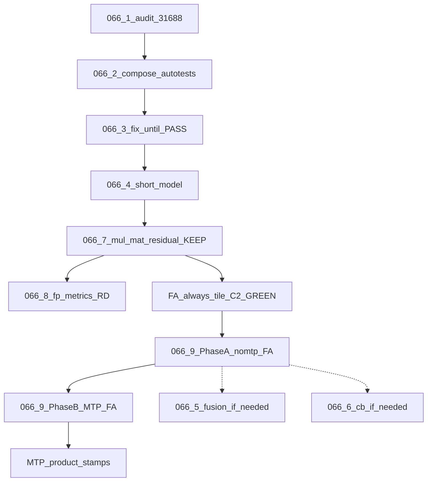

# TASK-066.0 — Overview (nomtp ubatch S8 vs S1024)

**Index:** [README-TASK066.md](README-TASK066.md)  
**Research inputs:** [`task066-hist/draft_mtp_research_task-066*.md`](task066-hist/)  
**Baseline stamp:** `logs/task066-ubatch-ladder-20261106T170944Z` (S8 vs S1024 DIFF @byte 80; `MUL_MM_MIN=8` debug)  
**Confirm stamp:** `logs/task066-ubatch-ladder-20261106T212703Z` (S8 vs S1024 DIFF @byte 182; product `MUL_MM_MIN` unset→7)  
**Post-tile ladder:** `logs/task066-ubatch-ladder-20261106T231804Z` (S1024 vs S8 DIFF @byte 329)

## Status

🟢 **066.7 KEEP** + **066.8 R&D DELIVERED** (2026-11-06). Findings frozen in [TASK-066.8 § Frozen findings](TASK-066.8-fp-comparison-metrics-rd.md).  
🟢 **FA always-tile (2026-11-07):** C2 GREEN; A0–A4 exact; C1 still RED HELP `first_token_diff` 0→8.  
🔓 **066.9 FA batch-invariance** — **Phase A (nomtp) active**; **Phase B (MTP) gated** until Phase A DoD. Spec: [TASK-066.9-fa-batch-invariance.md](TASK-066.9-fa-batch-invariance.md).  
🔓 **066.5 / 066.6** — fuse/CB only if C1 localize points away from FA.  
📋 **PR audit registry:** [TASK-066-pr-audit-registry.md](TASK-066-pr-audit-registry.md). Prior Stage 1 WAIVE ≠ Done. **MTP blocked** until 066.9 Phase A DoD (or explicit unlock here).

## Locked decisions

1. Goal: shrink nomtp cross-ubatch drift (primary **S8 vs S1024**; also `{256,512}`).
2. Order: 066.1–066.4 done → **066.7 KEEP** → **066.8 R&D** → FA always-tile (C2) → **066.9 Phase A** → (only then) **066.9 Phase B MTP**.
3. Backend: Metal first. CUDA out of scope for this numbered track.
4. Premature WAIVE forbidden as “Done”.
5. Raising `MUL_MM_MIN` to hide mm is **not** a fix. 066.7 **lowered** default to **7** so N=8 and large N share float-tile `mul_mm`. `#27441` stays closed unless corrected hypothesis.
6. `#30100` encode N/A until encode path exists (hist recheck).
7. **Every code change ships with autotests** (hard — see below). No silent “fix then maybe test later”.
8. **Primary gate for mm work = `mul-mat-residual`**, not e2e. Ladder / fullgraph confirm-only; MTP blocked until 066.9 Phase A.
9. **066.9 priority:** nomtp (Phase A) before MTP FA widths / #28108 spirit (Phase B). Product stays FA-on + turbo4.

## Evidence hierarchy (hard)

1. **Autotests accompany every change** — for each discrete patch/hypothesis:
   - add or extend a failing-closed corner that reproduces the bug/gap (**RED** on pre-fix HEAD);
   - implement the minimal fix;
   - same corner **GREEN**; log HELP / NO_EFFECT / REGRESS.
   - Forbidden: production/kernel edits without a new or extended autotest in the same change set; “covered by existing suite” only if that suite already fails closed on *this* gap (prove with RED before).
2. **For 066.7:** that suite is `SUITE=mul-mat-residual` (vs N=8). Do **not** run e2e ladder as the iteration gate.
3. **For 066.9 Phase A:** C1 / FA corners + C2 regression lock; ladder confirm after GREEN or named non-FA residual.
4. Isolation: one lever → HELP / NO_EFFECT / REGRESS → KEEP or revert.

## Progressive DoD

1. `SUITE=mul-mat-residual` PASS (all widths vs N=8). ✅ 066.7  
2. C2 FA multi-step bit-exact. ✅ always-tile  
3. **066.9 Phase A:** C1 GREEN or non-FA residual named; ladder vs `231804Z`.  
4. **066.9 Phase B** (gated): MTP verify-width FA autotest GREEN; then product MTP stamps.  
5. 066.8: dual-report mad/ULP + lit (ε is telemetry, not residual PASS). ✅  
“Owned huge DIFF@80” ≠ Done.

## Flow

## Out of scope

- MTP vs nomtp product stamps until **066.9 Phase A** DoD met (then Phase B).
- CUDA cluster work.
- Treating hist stage1-waive as success.
- Model-only KEEP without green, correctly composed autotests.
- Disabling multi-CB as a “fix”.
- FA-off / `ctv=f16` as product fix.
