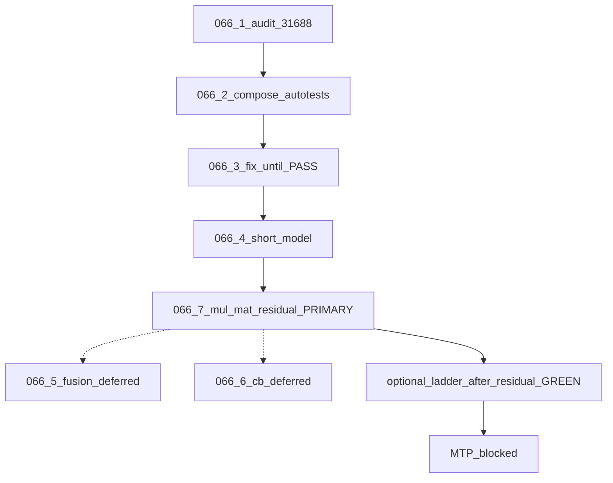

# TASK-066.0 — Overview (nomtp ubatch S8 vs S1024)

**Index:** [README-TASK066.md](README-TASK066.md)  
**Research inputs:** [`task066-hist/draft_mtp_research_task-066*.md`](task066-hist/)  
**Baseline stamp:** `logs/task066-ubatch-ladder-20261106T170944Z` (S8 vs S1024 DIFF @byte 80)

## Status

🔴 **Active: 066.7 REOPENED** (2026-11-06). Primary loop = `SUITE=mul-mat-residual` (row0 vs golden **N=8**; `{256,512,1024}` RED).  
Prior Stage 1 WAIVE is **not** Done. **MTP blocked.** E2E / ubatch ladder **not** required between 066.7 levers.

## Locked decisions

1. Goal: shrink nomtp cross-ubatch drift (primary **S8 vs S1024**; also `{256,512}`).
2. Order: 066.1–066.4 done → **066.7 now** (mul-mat-residual). 066.5/066.6 deferred unless residual GREEN still leaves product drift.
3. Backend: Metal first. CUDA out of scope for this numbered track.
4. Premature WAIVE forbidden as “Done”.
5. Raising `MUL_MM_MIN` to hide mm is **not** a fix. `#27441` may reopen only with corrected hypothesis + RED→GREEN autotest (hist: `task066-hist/TASK-066-p22-27441-audit.md`).
6. `#30100` encode N/A until encode path exists (hist recheck).
7. **Every code change ships with autotests** (hard — see below). No silent “fix then maybe test later”.
8. **Primary gate for mm work = `mul-mat-residual`**, not e2e. Ladder / fullgraph / MTP are confirm-only or blocked until residual GREEN.

## Evidence hierarchy (hard)

1. **Autotests accompany every change** — for each discrete patch/hypothesis:
   - add or extend a failing-closed corner that reproduces the bug/gap (**RED** on pre-fix HEAD);
   - implement the minimal fix;
   - same corner **GREEN**; log HELP / NO_EFFECT / REGRESS.
   - Forbidden: production/kernel edits without a new or extended autotest in the same change set; “covered by existing suite” only if that suite already fails closed on *this* gap (prove with RED before).
2. **For 066.7:** that suite is `SUITE=mul-mat-residual` (vs N=8). Do **not** run e2e ladder as the iteration gate.
3. Short model / ladder **optional confirm** only after residual PASS.
4. Isolation: one lever → HELP / NO_EFFECT / REGRESS → KEEP or revert.

## Progressive DoD

1. `SUITE=mul-mat-residual` PASS (all widths vs N=8).  
2. Then optional short nomtp ladder; KEEP if first-DIFF later **or** generations identical for S8 vs S1024.  
“Owned huge DIFF@80” ≠ Done.

## Flow

## Out of scope

- MTP vs nomtp product stamps until this track DoD met.
- CUDA cluster work.
- Treating hist stage1-waive as success.
- Model-only KEEP without green, correctly composed autotests.
- Disabling multi-CB as a “fix”.
