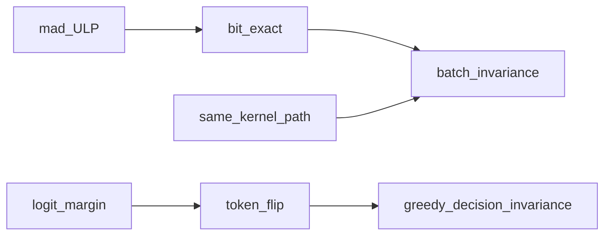

# TASK-066.8 — R&D: FP comparison metrics S1/S8/S256 (+S1024) and batch invariance

**Status:** 🟢 **R&D DELIVERED** (2026-11-06) — spec + lit + dual-report telemetry landed; bit-exact gate unchanged  
**Depends on:** 066.7 KEEP (residual bit-exact vs N=8 GREEN)  
**Lit dump:** [task066-hist/TASK-066.8-lit-notes.md](task066-hist/TASK-066.8-lit-notes.md)  
**Suite:** `SUITE=mul-mat` / `SUITE=mul-mat-residual` — **PASS gate stays bit-exact**; mad + max ULP are telemetry only

## Frozen findings (handoff)

1. **Root of residual RED (pre-066.7):** not “mm unstable in N”, but **cross-kernel** — N=8 on `mul_mv`, N≥256 on `mul_mm` at `MUL_MM_MIN=32`. Same-path (all-mv or all-mm) → bit-exact row0.
2. **Float ≠ pure math in bits:** `mul_mv` vs `mul_mm` differ by reduction order / intermediates (half→float-tile cut mad ~1e-4 → ~1 ULP); literature calls this **batch / path invariance**, not ε-equality.
3. **ε alone is not a product DoD:** Thinking Machines, vLLM #54506, MarginGate — O(ULP) logit drift can flip greedy `argmax`. Use mad/ULP as **telemetry**; keep bit-exact (unit) or decision-invariance (product/MTP).
4. **066.7 KEEP tradeoff (explicit):** default `MUL_MM_MIN=7` puts S8+ on float-tile mm (residual GREEN). `SUITE=mul-mat` vs-N=1 widths became `{2,3,4,5,7}` (N=8 dropped) — N=8 vs N=1 would still be ~1 ULP if re-added. Not the same as proving mm≡mv.
5. **Next product gate after unit GREEN:** optional short ladder S8 vs S1024 confirm; then 066.5/066.6 only if text still DIFF; MTP blocked until progressive DoD.

## Goal

Formalize how to compare Metal `MUL_MAT` / product ubatch numerics across widths  
`B ∈ {1, 8, 256, 1024}` (S1 / S8 / S256 / S1024), using literature on **batch invariance**,  
without replacing the 066.7 bit-exact residual gate by an ε-PASS.

## Locks

1. Do **not** weaken `SUITE=mul-mat-residual` to ε / ULP tolerance as PASS.  
2. Do **not** roll back 066.7 (`MUL_MM_MIN` default 7, float-tile q8_0/iq4_xs).  
3. Do **not** port CUDA `batch_invariant_ops` / vLLM kernels in this subtask.  
4. Metal / fork first; CUDA/vLLM citations are definitions and metrics only.  
5. Product `README.md` not updated in this R&D-only change set (§5.0).  
6. MTP remains blocked; e2e ladder is not the primary gate for 066.8.

## Mathematical formulation

One logical row (row0 / token column) at batch widths `B ∈ {1, 8, 256, 1024}`.

Let `y^(B) = F_B(x_0; W)` be the `MUL_MAT` (or logits) output for the **same** column  
when the activation batch has width `B`, and `F_B` is the Metal path chosen for that width  
(`mul_mv` / `mul_mm` / float-tile mm).

### Invariants

| # | Name | Definition |
|---|------|------------|
| 1 | **Batch invariance (bit-exact)** | `∀ B, B': y^(B) = y^(B')` (bitwise / `memcmp`) |
| 2 | **ε-equivalence** | `‖y^(B) − y^(B')‖_∞ ≤ ε` |
| 3 | **ULP-bound** | `ulp_diff(y^(B), y^(B')) ≤ U` (max pairwise float ULP over row0) |
| 4 | **Decision invariance (greedy)** | `argmax ℓ^(B) = argmax ℓ^(B')`; flip risk when top-1/top-2 margin is O(ULP) |
| 5 | **Kernel-path identity** | `path(B) = path(B')` often ⇒ bit-exact (066.7 diag: all-mv PASS, all-mm PASS; mixed FAIL) |

### Measurement matrix (research DoD)

| Compare | Product sense | Metrics |
|---------|---------------|---------|
| S1 vs S8 | decode vs small ubatch / verify class | exact, mad, max_ulp |
| S8 vs S256 | mid ubatch band | exact, mad, max_ulp |
| S8 vs S1024 | product ladder class | exact, mad, max_ulp (+ optional text DIFF) |
| same-path vs cross-path | `GGML_METAL_MUL_MM_MIN` A/B | path tag + metrics above |



## Recommendation (preliminary, locked for this track)

- **Unit `MUL_MAT` row0:** bit-exact remains the PASS gate (066.7 / Thinking Machines / Vosti-style contracts).  
- **Telemetry:** always print `mad` and `max_ulp` next to `exact` (implemented in `test-mul-mat-batch-invariance`).  
- **Product / MTP later:** prefer **decision invariance** + logit margin (MarginGate class), not `mad < 1e-5 ⇒ PASS`.  
- ε / ULP are **instruments**, not a substitute DoD without an explicit follow-up decision.

## DoD

- [x] This file: math + locks + recommendation.  
- [x] Lit notes under `task066-hist/TASK-066.8-lit-notes.md`.  
- [x] Index wiring: `README-TASK066.md`, `TASK-066.0-overview.md`, product pointer, fork `CHANGELOG.md` Unreleased.  
- [x] Dual-report in `test-mul-mat-batch-invariance`: log `max_ulp` beside `mad`; **exact** remains FAIL/PASS.  
- [ ] Optional later: ladder cells stamp logit-margin / token-flip (out of 066.8 code scope unless engaged).

## Commands

```bash
BUILD_DIR=build-task066-cb-ws SUITE=mul-mat-residual ./tests/run-task066-metal-corners.sh
BUILD_DIR=build-task066-cb-ws SUITE=mul-mat ./tests/run-task066-metal-corners.sh
# Expect VERDICT=PASS; lines include max_ulp=… telemetry
```

## Out of scope

- Replacing residual PASS with ε.  
- Rolling back `MUL_MM_MIN=7`.  
- Metal port of `batch_invariant_ops`.  
- Fullgraph / MTP e2e as primary.  
- Product README runbook fiction ahead of code.
